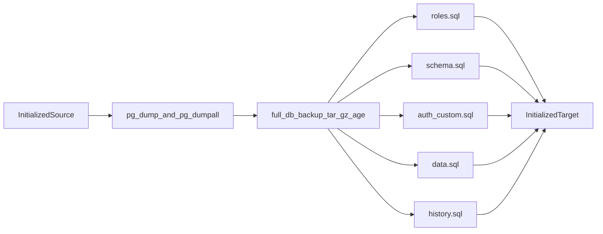

# Full database disaster recovery

Phase 1 designed the artifact. Phase 2 implements a local-only encrypted backup, catalog, inspect command, and restore into a database this repository labels disposable. It does not connect to staging or production, and it does not certify a destructive round trip against the long-lived local Supabase project.

Reviewed sources, without a connection to production or staging:

- [`docs/supabase-schema-full.sql`](supabase-schema-full.sql), the canonical application schema
- [`web/test/pg/auth-stub.sql`](../web/test/pg/auth-stub.sql), the disposable Auth stand-in used by existing tests
- [`scripts/sql_backup.py`](../scripts/sql_backup.py), [`scripts/sql_restore.py`](../scripts/sql_restore.py), and [`scripts/sql_backup_fetch.py`](../scripts/sql_backup_fetch.py)
- [Supabase backup and restore using the CLI](https://supabase.com/docs/guides/platform/migrating-within-supabase/backup-restore)
- [Supabase database backups](https://supabase.com/docs/guides/platform/backups)
- [PostgreSQL `pg_dump`](https://www.postgresql.org/docs/current/app-pgdump.html)
- Supabase CLI `pkg/migration/dump.go` at commit `952536a` (2026-04-16)

## Phase 2 decisions

Local inventory used Supabase CLI 2.121.0 and `supabase start` in this worktree. [`supabase/config.toml`](../supabase/config.toml) sets `major_version = 17`. The database container is `public.ecr.aws/supabase/postgres:17.11.0.004`. `SHOW server_version` returned `17.11`. `pg_dump --version` inside that container returned `pg_dump (PostgreSQL) 17.11`. The Windows PostgreSQL 16 install is not used. Tools refuse a client or server whose major version is not 17.

age is the WinGet package FiloSottile.age 1.3.2 when `age` is not already on `PATH`. The tool discovers that executable and does not download another copy. No full-database age identity is configured in the environment. Tests generate an ephemeral key pair in a temporary directory and delete it. They do not read, print, or replace `SQL_BACKUP_AGE_RECIPIENT` or `SQL_BACKUP_AGE_IDENTITY`. The backup recipient remains `FULL_DB_BACKUP_AGE_RECIPIENT`, a separate public key from the portable guild backup. That variable is unset here, so this phase did not create a long-lived key.

The hosted server major version is still unknown. [`docs/full-db-hosted-inventory.sql`](full-db-hosted-inventory.sql) is the read-only procedure for a later check. `python scripts/full_db_inspect.py --hosted-procedure` prints that path and does not connect. Backup and restore accept only `localhost`, `127.0.0.1`, and `::1`.

`cron`, `net`, and `pgmq` are not installed on this local server. The catalog records each absence and the reason. When those schemas exist, their table rows are captured and restored only into `full_db_captured`, so jobs, HTTP calls, and queue messages are not started. `supabase_functions.hooks` is installed and follows that same inert restore. `vault.secrets` ciphertext is captured. `INSERT` into that table as `postgres` fails with `permission denied for function _crypto_aead_det_noncegen`, so those rows are archived in `full_db_captured` and are not loaded back into `vault`. `vault.decrypted_secrets` is a view and is not dumped. `storage.buckets_vectors` and `storage.vector_indexes` are ordinary tables on this image and are included in the data dump.

Auth tables observed on this server, and not taken from the test stub, are `audit_log_entries`, `custom_oauth_providers`, `flow_state`, `identities`, `instances`, `mfa_amr_claims`, `mfa_challenges`, `mfa_factors`, `mfa_recovery_code_sets`, `mfa_recovery_codes`, `oauth_authorizations`, `oauth_client_states`, `oauth_clients`, `oauth_consents`, `one_time_tokens`, `refresh_tokens`, `saml_providers`, `saml_relay_states`, `schema_migrations`, `scim_tokens`, `scim_users`, `sessions`, `sso_domains`, `sso_providers`, `users`, `webauthn_challenges`, and `webauthn_credentials`.

Commands:

- `python scripts/full_db_backup.py --out <file>`
- `python scripts/full_db_inspect.py --artifact <file> --identity <file>`
- `python scripts/full_db_restore.py --artifact <file> --identity <file> --disposable-label full-db-restore-<name> --confirm "RESTORE FULL full-db-restore-<name>"`

Restore refuses a destination that does not already contain `full_db_meta.disposable_marker` with that label. The local `supabase start` database does not have that marker.

## Scope and threat model

The backup exists for two failures:

- The Supabase project is deleted. Platform daily backups and point-in-time recovery are deleted with the project.
- The database is logically damaged, and an off-site copy is the recovery source. Hosted physical restore remains the path for in-place recovery of the same project.

The artifact must be enough to recreate, on a newly initialized Supabase project:

- every `public` table row, including caches and derived tables
- `profiles`, authorization roles stored on profiles, and `officer_audit_log`
- authentication table rows the platform will accept back into an existing `auth` schema
- storage metadata rows
- table definitions, columns, constraints, indexes, views, functions, procedures, triggers, row-level security policies, grants, and sequence positions
- extension identity, migration history, and publication membership, recorded even when the object itself is not recreated

It must survive an attacker who can download a future GitHub Actions artifact. The uploaded bytes are ciphertext. The private key stays offline. Password hashes, emails, and audit rows use a different key from the portable guild backup.

The dangerous operator mistake is restoring this artifact onto the wrong project, or feeding it to the portable guild restore. Identity checks and a distinct format close that path. The dangerous technical mistake is `pg_restore --clean` against schemas Supabase owns.

Threats this design does not cover: a stolen offline age identity, a compromised `postgres` role at dump time, or malware already inside a function body. `pg_dump` output is SQL. Restoring it executes that SQL. The checksum proves the file was not edited after the dump. It does not prove the source database was trustworthy.

## Architecture recommendation

Take a logical backup as plain SQL, encrypt it, and restore it into a project that Supabase or `supabase start` has already initialized. Keep platform schemas in place. Replace `public` definitions and reload table data, including `auth` and storage metadata.



Call `pg_dump` and `pg_dumpall` directly. Pin the exclusion lists in this document to CLI commit `952536a`, and re-read that file before implementation. Do not pipe the dump through `supabase db dump`. An older `dump_schema.sh` ended in `uniq` and could delete identical SQL lines.

Same-project physical backup and point-in-time recovery stay the hosted in-place path. This bundle is the off-site copy that survives project deletion, and the artifact a local round-trip test restores.

### Why plain SQL, in the Supabase three-file shape

Supabase's documented logical restore is:

1. `roles.sql` from `supabase db dump --role-only`
2. `schema.sql` from a schema dump that excludes managed schemas
3. `psql --single-transaction`, with `SET session_replication_role = replica` before `data.sql`
4. A separate dump of `supabase_migrations` when migration history must survive

A single custom-format archive (`pg_dump -Fc`) plus `pg_restore --clean` is the wrong vehicle:

- A full `pg_dump` includes platform schemas. Restoring them recreates objects owned by `supabase_admin`, or drops objects the running Auth, Storage, and Realtime services still need.
- `--clean`, `--if-exists`, and `--no-owner` are applied by `pg_restore`, not stored as reviewable SQL. The archive cannot carry the text filters Supabase requires: omit `ALTER ... OWNER TO supabase_admin`, omit grants of reserved roles, and do not pin `CREATE EXTENSION pgsodium` to a version.
- `pg_dump`'s own warning applies: a restore executes arbitrary SQL chosen by the source. Plain SQL can be read before it is loaded. The guild database is small enough that parallel restore is not a reason to give that up.
- Custom format is still a valid PostgreSQL archive for a database you fully own. It is a poor fit for an already initialized Supabase project.

`pg_dump` exports one database. Roles are global. `pg_dumpall --roles-only`, filtered as below, is the role source. `pg_dump` does not replace it.

## Chosen backup and restore format

Artifact file: `full-db-backup-<UTC>.tar.gz.age`

Manifest `format_version`: `full-db-1`

The portable backup uses `format_version` `"1"` and file names that match `sql-backup-`. [`scripts/sql_restore.py`](../scripts/sql_restore.py) rejects any other `format_version`. [`scripts/sql_backup_fetch.py`](../scripts/sql_backup_fetch.py) only lists `sql-backup-<stamp>`, `sql-backup-weekly-*`, and `sql-backup-monthly-*`. A `full-db-backup-*` artifact is invisible to that fetcher. This phase does not change either script.

After `age` decrypt and `tar`, the archive contains:

| Member | Contents |
| --- | --- |
| `roles.sql` | Non-reserved roles and memberships. No passwords. |
| `schema.sql` | Schema-only SQL for schemas outside the platform exclusion list. For this application that is `public`. `--no-owner`. No `DROP SCHEMA`. |
| `auth-custom.sql` | Application objects that sit on managed schemas. Today that is the trigger `on_auth_user_created` on `auth.users`. |
| `data.sql` | `pg_dump --data-only` using `COPY`, for `public`, `auth`, and storage metadata. |
| `history.sql` | Schema and data for `supabase_migrations` only. The file is present even when the schema has no rows. |
| `catalog.json` | Dump-time `pg_catalog` inventory. |
| `manifest.json` | Identity, counts, classifications, checksums. |
| `SHA256SUMS` | SHA-256 of every other member. |
| `summary.txt` | The same identity and counts, with no row samples and no secrets. |

`data.sql` includes sequence `setval` lines. `schema.sql` includes sequence definitions.

### Exclusion lists

Schema dump excludes the CLI `InternalSchemas` list from commit `952536a`:

`information_schema`, `pg_*`, `_analytics`, `_realtime`, `_supavisor`, `auth`, `etl`, `extensions`, `pgbouncer`, `realtime`, `storage`, `supabase_functions`, `supabase_migrations`, `cron`, `dbdev`, `graphql`, `graphql_public`, `net`, `pgmq`, `pgsodium`, `pgsodium_masks`, `pgtle`, `repack`, `tiger`, `tiger_data`, `timescaledb_*`, `_timescaledb_*`, `topology`, `vault`.

The schema dump still excludes platform schemas, because those definitions already exist on an initialized project. The data dump captures `public`, `auth`, `storage` (including `buckets_vectors` and `vector_indexes` on this image), and any installed operational schema: `cron`, `net`, `pgmq`, `supabase_functions`, `realtime`, and `_realtime`. `vault.secrets` is captured and not loaded back into `vault`. A schema that is not installed is listed in the catalog with an exclusion reason. It is not a silent skip of rows that existed.

Reserved roles, omitted from `roles.sql` and never given a new password by the restore:

`anon`, `authenticated`, `authenticator`, `cli_login_.*`, `dashboard_user`, `pgbouncer`, `postgres`, `service_role`, `supabase_.*`, `pgsodium_keyholder`, `pgsodium_keyiduser`, `pgsodium_keymaker`, `pgtle_admin`.

`auth-custom.sql` is not a dump of the `auth` schema. The generator copies the canonical trigger:

```sql
CREATE TRIGGER on_auth_user_created
  AFTER INSERT ON auth.users
  FOR EACH ROW EXECUTE FUNCTION public.handle_new_user();
```

The function body lives in `public` and is already in `schema.sql`. The trigger file must not contain `CREATE SCHEMA auth`, `CREATE TABLE auth.users`, or `DROP SCHEMA`.

### Restore order

Implemented for a local disposable database. The target is an initialized Postgres 17 server. The restore never drops `auth`, `storage`, `realtime`, `vault`, `extensions`, or `pgsodium`.

1. Refuse the run unless the destination name, host, database, and project ref match the configured identity, and the operator typed `RESTORE FULL <destination>`. The portable phrase `RESTORE <destination>` does not authorize this restore.
2. Require the `pg_dump` and `psql` client major versions to be greater than or equal to the source server major.
3. Apply the filtered `roles.sql`. Do not change passwords of reserved roles.
4. Apply `schema.sql` and `auth-custom.sql` onto the existing project. Public objects are replaced with `CREATE OR REPLACE` and policy replacement. `DROP SCHEMA public CASCADE` is not the mechanism.
5. `SET session_replication_role = replica`, then load `data.sql` and `history.sql` in the same `psql --single-transaction --set ON_ERROR_STOP=1` session. Replica mode skips user triggers, so `handle_new_user` and the DKP triggers do not double-write. It also skips foreign-key triggers, so a post-load constraint scan is mandatory.
6. Apply sequence `setval` lines from the dump.
7. Force `public.restore_in_progress.in_progress` to false before commit.
8. If `catalog.json` recorded public tables in the `supabase_realtime` publication, add those tables back to the publication that already exists. Do not drop the publication.
9. Do not load Vault rows. Do not call the pgsodium Management API from the automated path.

A failed statement rolls the transaction back. Hosted connections use the session pooler on port 5432 with `sslmode=require`. Port 6543 is refused, as it already is for the portable restore.

## Encryption and manifest design

Encryption is `age`, then the same wrapper shape as the portable backup: gzip-compressed tar, then `age`. Proposed secret names, not created in this phase:

| Name | Kind | Value |
| --- | --- | --- |
| `FULL_DB_BACKUP_AGE_RECIPIENT` | Public key | `age1...` line from a new `age-keygen` run |
| `FULL_DB_BACKUP_AGE_IDENTITY` | Private key | Offline. Never a secret of a backup workflow. |

The portable secrets `SQL_BACKUP_AGE_RECIPIENT` and `SQL_BACKUP_AGE_IDENTITY` stay on the guild-data artifact. A person who can decrypt a portable backup cannot decrypt password hashes or officer audit rows.

The dump sets `PGOPTIONS=-c default_transaction_read_only=on` and passes the connection through libpq environment variables. Logs list object names and counts. They omit the connection string, passwords, the age recipient, row contents, and hashes.

`SHA256SUMS` covers `roles.sql`, `schema.sql`, `auth-custom.sql`, `data.sql`, `history.sql`, `catalog.json`, `manifest.json`, and `summary.txt`. The manifest stores those digests again. Decrypt fails closed when the sums disagree.

`catalog.json` is a list of objects. Every object has `schema`, `name`, `object_type`, `classification`, and `row_count` when the object is a table or sequence. An object omitted from every SQL member also has `exclusion_reason`. Classifications are `FULLY_RECOVERABLE`, `CONDITIONALLY_RECOVERABLE`, `REQUIRES_SEPARATE_BACKUP`, and `UNSUPPORTED`.

The backup fails if any non-system object is missing a classification, or if an omitted object is missing an exclusion reason. A later test fails if a table in the canonical schema is absent from the catalog. An extra `public` relation also fails. An excluded object's expected count is its source count plus the reason. The expected count is not zero.

Illustrative manifest. Counts are not a real backup.

```json
{
  "format_version": "full-db-1",
  "artifact_kind": "full-database",
  "source_repository": "owner/dkp",
  "source_commit_sha": "abc123",
  "created_at": "2026-10-15T23:00:00Z",
  "canonical_schema_source": "docs/supabase-schema-full.sql",
  "canonical_schema_sha256": "sha256:...",
  "postgresql_version": "17.x",
  "server_version_num": 170000,
  "pg_dump_version_num": 170000,
  "exclusion_list_source": "supabase/cli pkg/migration/dump.go@952536a",
  "source_project_ref": "projectref",
  "source_host": "aws-0-us-east-1.pooler.supabase.com",
  "source_database": "postgres",
  "system_identifier": null,
  "system_identifier_reason": "not read in this design phase",
  "included_sql": ["roles.sql", "schema.sql", "auth-custom.sql", "data.sql", "history.sql"],
  "row_counts": {"public.characters": 0, "auth.users": 0},
  "storage_bytes": "not_applicable",
  "checksums": {"data.sql": "sha256:..."}
}
```

`summary.txt` repeats `format_version`, the project ref, the server version, and the counts. It does not repeat SQL, emails, or keys.

`catalog.json` also records extension names and versions, publication membership, role attributes without passwords, and sequence `last_value`. Those rows follow the same classification rule.

## Database identity protections

The manifest records:

- project ref, taken from the session-pooler username `postgres.<ref>` or from a direct host `db.<ref>.supabase.co`
- host, with no user and no password
- database name
- `server_version` and `server_version_num`
- `system_identifier` from `pg_control_system()` when the role can read it

The restore compares that identity with the destination configuration. A hosted target is accepted only when the name, host, database, and project ref agree with the connection, using the same shape as the portable restore's destination check. `localhost` and `127.0.0.1` are the local test hosts. A future Actions job refuses those hosts.

Confirmation text is `RESTORE FULL <destination>`. A portable restore confirmation must not be parsed as this phrase.

The artifact stores no connection string, role password, JWT secret, service-role key, Vault root key, or OAuth client secret. A generator scan rejects the archive if `roles.sql` contains a `PASSWORD` clause.

`public.restore_in_progress` is dumped and then forced false before commit, so a snapshot taken during another restore cannot leave the flag set.

## Full object inventory

Classifications:

| Class | Meaning |
| --- | --- |
| FULLY RECOVERABLE | The object definition or rows are in this artifact and can be loaded into an initialized project. |
| CONDITIONALLY RECOVERABLE | Rows or a small application delta can be loaded only because the platform already created the schema, extension, or publication. |
| REQUIRES SEPARATE BACKUP | The bytes or secret are outside this logical dump and need their own copy. |
| UNSUPPORTED | Ordinary `pg_dump` or `COPY` cannot restore it. Use platform backup, or accept the loss. |

Evidence for `public` is the canonical schema file at the commit this branch was cut from (`f98834dde`). Evidence for managed schemas is the CLI list and Supabase's restore guide. Row counts are not in this document because this phase did not connect to a database. The future catalog stores them.

### Public tables

The canonical file contains 26 `CREATE TABLE` statements. All 26 tables receive `ENABLE ROW LEVEL SECURITY`. The full backup includes every row. The portable backup includes 13 of them and rebuilds or omits the rest.

| Table | Full backup | Portable backup | Class | Evidence |
| --- | --- | --- | --- | --- |
| `characters` | data + definition | data only | FULLY RECOVERABLE | Canonical table. Portable allowlist. |
| `accounts` | data + definition | data only | FULLY RECOVERABLE | Game account, not a login. |
| `character_account` | data + definition | data only | FULLY RECOVERABLE | Canonical table. |
| `raids` | data + definition | data only | FULLY RECOVERABLE | Canonical table. |
| `raid_events` | data + definition | data only | FULLY RECOVERABLE | `id` is `BIGSERIAL`. |
| `raid_attendance` | data + definition | data only | FULLY RECOVERABLE | `id` is `BIGSERIAL`. |
| `raid_event_attendance` | data + definition | data only | FULLY RECOVERABLE | `id` is `BIGSERIAL`. |
| `raid_loot` | data + definition | data only | FULLY RECOVERABLE | `id` is `BIGSERIAL`. |
| `loot_assignment` | data + definition | data only | FULLY RECOVERABLE | Canonical table. |
| `dkp_adjustments` | data + definition | data only | FULLY RECOVERABLE | Canonical table. |
| `raid_classifications` | data + definition | data only | FULLY RECOVERABLE | Canonical table. |
| `active_raiders` | data + definition | data only | FULLY RECOVERABLE | Officer pin list. |
| `active_accounts` | data + definition | data only | FULLY RECOVERABLE | Officer pin list. |
| `profiles` | data + definition | excluded | FULLY RECOVERABLE | `id` references `auth.users`. Load users first. Portable restore keeps the destination profiles. |
| `officer_audit_log` | data + definition | excluded | FULLY RECOVERABLE | `actor_id` references `auth.users`. `id` defaults to `gen_random_uuid()`. Stores `actor_email`. |
| `raid_dkp_totals` | data + definition | rebuilt | FULLY RECOVERABLE | Stored cache. Full recovery keeps the rows. |
| `raid_attendance_dkp` | data + definition | rebuilt | FULLY RECOVERABLE | Stored cache. |
| `raid_attendance_dkp_by_account` | data + definition | rebuilt | FULLY RECOVERABLE | Stored cache. |
| `dkp_summary` | data + definition | rebuilt | FULLY RECOVERABLE | Stored cache. |
| `account_dkp_summary` | data + definition | rebuilt | FULLY RECOVERABLE | Stored cache. |
| `dkp_period_totals` | data + definition | rebuilt | FULLY RECOVERABLE | Stored cache. |
| `character_dkp_spent` | data + definition | rebuilt | FULLY RECOVERABLE | Stored cache. Absent from the CSV export as well. |
| `character_loot_assignment_counts` | data + definition | rebuilt | FULLY RECOVERABLE | Stored cache. |
| `bid_portfolio_auction_fact` | data + definition | cleared | FULLY RECOVERABLE | Portable restore leaves it empty. Full recovery keeps the rows. |
| `account_class_coverage` | data + definition | excluded | FULLY RECOVERABLE | Magelo rankings cache. Full recovery keeps the rows. |
| `restore_in_progress` | data + definition | excluded | CONDITIONALLY RECOVERABLE | One operational row. Restore forces `in_progress` false before commit. |

### Public definitions

| Object | Count in the canonical file | Class | Evidence |
| --- | --- | --- | --- |
| Tables | 26 | FULLY RECOVERABLE | `CREATE TABLE` statements listed above. |
| Views | 6 distinct | FULLY RECOVERABLE | `raid_events_ordered`, `officer_audit_loot`, `raid_loot_with_assignment`, `raid_loot_history`, `character_loot_assignment_count`, `guild_loot_sale_enriched`. All use `security_invoker`. `character_loot_assignment_count` is created, dropped, and created again. The second definition is the live one. |
| Materialized views | 0 | FULLY RECOVERABLE | No `CREATE MATERIALIZED VIEW`. A later catalog probe fails if one appears without a classification. |
| Functions | 96 `CREATE OR REPLACE FUNCTION` statements | FULLY RECOVERABLE | Statement count, not a distinct `pg_proc` count. The catalog probe is the acceptance count, because a later statement can replace an earlier one. |
| Procedures | 1 | FULLY RECOVERABLE | `public.dba_backfill_bid_portfolio_range`. |
| Triggers on `public` | 20 | FULLY RECOVERABLE | The 21st trigger, `on_auth_user_created`, is on `auth.users` and is CONDITIONALLY RECOVERABLE through `auth-custom.sql`. |
| RLS policies | 49 `CREATE POLICY` statements | FULLY RECOVERABLE | `Officers manage active_raiders` is created twice. The second statement replaces the first, so the live catalog has 48 policies unless another name is also repeated. The catalog probe is the acceptance count. |
| RLS enabled | 26 tables | FULLY RECOVERABLE | One `ENABLE ROW LEVEL SECURITY` per table. |
| Secondary indexes | 24 `CREATE INDEX` statements | FULLY RECOVERABLE | Includes unique indexes `uq_raid_event_attendance_raid_event_char_id` and `uq_raid_event_attendance_raid_event_character_name`. Primary-key indexes are created with the tables. |
| Grants and revokes | present throughout the file | FULLY RECOVERABLE | Included in `schema.sql`. The catalog records privilege rows so a missing grant fails the backup. |
| Comments | present | FULLY RECOVERABLE | `pg_dump` emits `COMMENT` statements. |
| Sequences | 4 `BIGSERIAL` columns | FULLY RECOVERABLE | `raid_events.id`, `raid_loot.id`, `raid_attendance.id`, `raid_event_attendance.id`. Values travel as `setval`. `officer_audit_log.id` uses `gen_random_uuid()` and has no sequence. |
| Ownership by `supabase_admin` | platform | UNSUPPORTED | `schema.sql` uses `--no-owner`. Hosted `postgres` cannot assign ownership to `supabase_admin`. |
| Extensions created by this file | 0 | CONDITIONALLY RECOVERABLE | The canonical schema does not contain `CREATE EXTENSION`. Platform extensions must already be enabled on the target. Do not emit a version-pinned `CREATE EXTENSION pgsodium`. |

Dropped definitions are part of the live schema and must not reappear. The canonical file drops `trigger_loot_assignment_spent` and `apply_account_spent_deltas`. A catalog that still contains them fails the backup until someone classifies the drift.

### Authentication and other managed schemas

[`web/test/pg/auth-stub.sql`](../web/test/pg/auth-stub.sql) creates `auth.users`, `auth.identities`, and `auth.uid()`. That is a test double. It is not the GoTrue schema. This design does not pretend to list every current `auth` or `storage` table. The dump-time catalog does that, and the backup fails if a table in those schemas has no classification.

| Object | Class | Evidence |
| --- | --- | --- |
| `auth` table rows, including `auth.users` and `auth.identities` | CONDITIONALLY RECOVERABLE | CLI data dump includes `auth`. Definitions stay the ones the platform created. Password hashes restore. Plaintext passwords are not in the database. The auth stub is not the table list. |
| `on_auth_user_created` | CONDITIONALLY RECOVERABLE | Canonical trigger on `auth.users` calling `public.handle_new_user()`. Supabase documents this class of customization separately from the managed schema. |
| `auth.uid()` and GoTrue functions | UNSUPPORTED for replacement | Platform-owned. The stub function is for disposable Postgres only. |
| `storage.buckets`, `storage.objects`, and other ordinary storage metadata tables | CONDITIONALLY RECOVERABLE | CLI data dump includes `storage`. Application code in this repository does not call the Storage API. Metadata is still dumped so a future bucket is not silent. |
| `storage.buckets_vectors`, `storage.vector_indexes` | CONDITIONALLY RECOVERABLE | On PostgreSQL 17.11 image `17.11.0.004` both are ordinary tables. They are included in the data dump. The official `-x` exclusion is not applied here. |
| Storage object bytes | REQUIRES SEPARATE BACKUP | Supabase: database backups store metadata only. Deleting an object after the backup is not undone by a database restore. |
| `supabase_migrations` | FULLY RECOVERABLE | Official separate history dump. This repository applies `docs/supabase-schema-full.sql` rather than CLI migration files, so the table may be empty. Empty history does not replace the canonical schema file. |
| `realtime` schema and its internal tables | CONDITIONALLY RECOVERABLE | Rows are captured and restored into `full_db_captured`. The live Realtime tables are not rewritten, so the service is not handed restored messages. |
| Membership of public tables in `supabase_realtime` | CONDITIONALLY RECOVERABLE | Recorded in `catalog.json` and re-applied to the existing publication. |
| `vault.secrets` | UNSUPPORTED for live reload | Ciphertext is captured. `INSERT` as `postgres` fails with `permission denied for function _crypto_aead_det_noncegen`, so restore writes `full_db_captured.vault__secrets` and does not load `vault.secrets`. `vault.decrypted_secrets` is not dumped. The root key is not in the database. |
| Project root encryption key | REQUIRES SEPARATE BACKUP | Management API `GET/PUT /v1/projects/{ref}/pgsodium` returns the 64-character hex key for an active project only. Dumps never contain it. Same-project physical restore and PITR keep the key. A new project has a new key until an operator copies the old one. This automated design does not copy it. |
| `cron`, `net`, `pgmq`, `supabase_functions`, `_realtime` rows | CONDITIONALLY RECOVERABLE | Present schemas are captured and restored only into `full_db_captured`. Jobs, HTTP calls, and queue messages are not started. `cron`, `net`, and `pgmq` are absent on this local server and that absence is a catalog entry. |
| `extensions`, `pgbouncer`, `_analytics`, `_realtime`, `_supavisor`, `etl`, `graphql`, `graphql_public`, and the other excluded extension schemas | UNSUPPORTED | Platform or extension owned. Listed so a surprise schema still needs an exclusion reason. |
| Custom `LOGIN` role passwords | REQUIRES SEPARATE BACKUP | Supabase daily backups omit them. `pg_dumpall` on hosted Postgres often cannot read them, and this design refuses to store them. No custom login role is created by this repository. The `dkp_backup_reader` example in the portable backup doc is not applied. |
| Reserved role passwords and the JWT secret | UNSUPPORTED | Platform configuration. Reset through the dashboard if a new project needs them. |
| API keys, Discord client id and secret, redirect URLs, site URL, SMTP, email templates | UNSUPPORTED | [`docs/discord.md`](discord.md) configures Discord in the Supabase dashboard. Those values are not in `pg_dump`. |
| Edge Functions | UNSUPPORTED | No `supabase/functions` directory. Supabase documents a separate CLI download. There is nothing to download today. |
| Large objects | FULLY RECOVERABLE when present | `pg_dump --data-only` includes them unless disabled. The catalog records `pg_largeobject_metadata`. A zero count is an exclusion with reason `none present`. |
| Read replicas, compute size, network restrictions, custom domain, SSL enforcement | UNSUPPORTED | Project settings, not catalog objects. |

## Explicit limitations

- The restore target must already be an initialized Supabase database. This artifact does not create a project, a database, or the `auth` and `storage` schemas.
- Vault ciphertext and the root key are outside the automated restore. If this project later stores Vault secrets, same-project PITR is the recovery path that keeps them readable.
- Storage file bytes are outside the database dump.
- OAuth configuration, API keys, and Edge Functions are outside the database dump.
- `schema.sql` omits `ALTER DEFAULT PRIVILEGES`. The restoring `postgres` role cannot change default privileges owned by another role. Explicit `GRANT` statements for existing objects stay in the file.
- `session_replication_role = replica` skips foreign-key checks during load. A restore that skips the post-load scan can commit orphan rows.
- Role passwords are not in the artifact. A custom login role restored from `roles.sql` cannot log in until an operator sets a new password.
- `supabase_migrations` does not describe `docs/supabase-schema-full.sql`. Schema drift is detected by the catalog and by `canonical_schema_sha256`, which is provenance. A matching file hash does not by itself prove the live catalog matches the file. The portable backup already records that distinction for its own probe.
- Client `pg_dump` older than the server is refused. PostgreSQL cannot dump a newer major version.
- Hosted `postgres` is not a full superuser. `pg_dumpall --roles-only` may fail. The fallback is a catalog export of role name, login flag, bypass-RLS flag, and memberships, still without passwords. Implementation must prove which path works on a local stack before any hosted dump.
- This phase did not measure production. Bucket counts, Vault use, cron jobs, custom roles, realtime membership, and the hosted Postgres major version are unknown. The repository shows no Storage client, no Vault SQL, no `supabase/migrations`, and no Edge Functions.

## Permissions and PostgreSQL version

Dump and the future restore use the session-mode `postgres` role:

- port 5432, `sslmode=require` on a hosted connection
- `default_transaction_read_only=on` during the dump
- the `postgres` role bypasses row-level security, so a policy cannot hide rows from the backup

A `SELECT`-only role is the wrong dump role for this artifact. It cannot read `auth` tables owned by `supabase_auth_admin`, and it cannot emit roles.

`SET session_replication_role = replica` is part of Supabase's own restore command, run as `postgres`. The local round-trip must prove the initialized stack still allows it. A role that cannot set it cannot load `auth.users` safely, because `on_auth_user_created` would insert a second profile row.

Version rule: the full-database tools accept only PostgreSQL 17. The client is `pg_dump` inside `public.ecr.aws/supabase/postgres:17.11.0.004` or the `postgres:17` image. The Windows PostgreSQL 16 install is not used. The hosted major version has not been queried. A later hosted restore must run [`docs/full-db-hosted-inventory.sql`](full-db-hosted-inventory.sql) first and must not assume the hosted major can be changed.

## Safest restoration model

Restore onto a new initialized project, or onto a local `supabase start` database. Leave the platform schemas in place. Reload `public` and the accepted managed table data in one transaction.

That is safer than:

- `pg_restore --clean` of a cluster-wide custom archive, which drops platform objects
- restoring `public` by `DROP SCHEMA public CASCADE`, which drops grants and views the platform attached to `public`
- in-place logical restore of production as the first implementation

Hosted in-place recovery of the same project stays on Supabase physical backup or PITR. Those keep the root encryption key, reserved-role passwords, and Realtime's replication slot. Logical restore into a new project does not. Supabase also warns that a binary clone starts `pg_cron`, `pg_net`, and wrapper jobs immediately. This backup captures those rows when the schemas exist and restores them into `full_db_captured`, so the restored database does not start the jobs.

A later production procedure, not part of this phase, would take this full backup of the destination before writing, then require `RESTORE FULL <destination>` from a protected environment. The portable workflow's pre-restore guild backup does not satisfy that requirement, because it omits authentication and schema.

## Local test architecture

`python scripts/test_full_db.py` is the Phase 2 test. It does not use a production URL, a real email address, a real password, or a Discord client secret. It does not restore onto the `supabase start` database.

The inventory check reads the running local Supabase database on PostgreSQL 17 and does not write to it. The restore check starts two containers from `public.ecr.aws/supabase/postgres:17.11.0.004`, named `full-db-src-<pid>` and `full-db-dst-<pid>`, and removes those containers. The raw image does not include the GoTrue `auth.identities` table or the storage tables, so the test copies those schema definitions, read-only, from the running local database before loading fixtures. The destination must contain `full_db_meta.disposable_marker`.

Fixtures are synthetic:

- user id `11111111-1111-4111-8111-111111111111`, email `user-a@example.test`, password hash `fixture-bcrypt-not-a-login`
- one `profiles` row with role `officer`
- one `officer_audit_log` row for that user
- one character named `Fixturetoon`
- one `supabase_functions.hooks` row named `fixture-hook-do-not-fire`
- one Vault secret created with `vault.create_secret` and named `phase2-probe`

The test restores onto the second container, then checks the email, the hash, the profile role, the character, a live hook count of zero, the captured hook name, a live `vault.secrets` count of zero, the captured secret name, `restore_in_progress` false, and `on_auth_user_created` calling `handle_new_user`. It removes only those two containers. It does not call `supabase.co`. Certification against the long-lived `supabase start` database is a later step and has not been run.

A negative check feeds a `full-db-1` manifest to the portable parser. Current code raises `Artifact format_version is not supported.` That check can live beside the new tests. It does not require an edit to the portable parser unless a future change weakens that comparison.

`DKP_PG_TEST=1` should fail the suite when Docker, `psql`, `pg_dump`, or `age` is missing, matching the portable tests.

## Recovery acceptance criteria

A future restore is acceptable only when all of the following hold:

- The artifact decrypts with the full-database age identity, and `SHA256SUMS` matches.
- `format_version` is `full-db-1`.
- Destination identity matches the confirmation `RESTORE FULL <destination>`.
- Client major version is at least the source server major.
- Every catalog object exists on the destination, or the catalog names an exclusion reason.
- `public` relation names match the catalog. Extra and missing relations both fail.
- Table row counts match the manifest, except `restore_in_progress`, which must be the single row with `in_progress` false.
- Sequence `last_value` matches the manifest for the four `BIGSERIAL` sequences.
- `on_auth_user_created` exists on `auth.users` and calls `public.handle_new_user()`.
- Profile and audit rows point at restored `auth.users` ids. The bcrypt hash matches the fixture byte for byte.
- A foreign-key and check-constraint scan returns no violations. Replica mode skipped those checks during load.
- `roles.sql` contains no `PASSWORD` clause and no `CREATE ROLE` for a reserved role.
- `auth-custom.sql` contains no `CREATE SCHEMA auth` and no `CREATE TABLE auth.users`.
- `vault.secrets` and `vault.decrypted_secrets` were not loaded into `vault`. Captured ciphertext, when present, is in `full_db_captured`.
- `storage.buckets_vectors` and `storage.vector_indexes` are restored with the other storage tables when the source had them.
- `cron`, `net`, `pgmq`, `supabase_functions`, `realtime`, and `_realtime` rows, when present, were not loaded into the live schemas. They are in `full_db_captured`, or the catalog says the schema was absent.
- The portable backup scripts and workflows are unchanged by the restore implementation.

## Optional Storage object-byte backup

This repository does not use Supabase Storage. The first catalog that shows zero rows in `storage.buckets` sets `storage_bytes` to `not_applicable`.

If a later catalog shows buckets, bytes are a sibling artifact, not a member of `full-db-backup-*`:

- name `full-db-storage-<UTC>.tar.gz.age`
- same full-database age recipient
- a manifest of bucket name, object path, size, content type, and SHA-256
- object bytes, encrypted inside the archive
- restore through the Storage API after `storage.objects` metadata is committed

The database restore must succeed when the byte artifact is absent. Metadata without bytes is a visible gap: the acceptance report lists each `storage.objects` name whose bytes were not in the sibling artifact. It does not fail the database restore on that gap unless the operator asked for a byte-complete restore.

Supabase's published storage migration lists and copies objects with the service role. That is the model for the sibling artifact. It is out of scope for this phase.

## Separation from the portable guild-data restore

The portable backup remains the way to move guild DKP between independent projects that already have the canonical schema and their own logins.

| | Portable `sql-backup-*` | Full `full-db-backup-*` |
| --- | --- | --- |
| `format_version` | `1` | `full-db-1` |
| SQL shape | `data.sql` for 13 tables | `roles.sql`, `schema.sql`, `auth-custom.sql`, `data.sql`, `history.sql` |
| Schema | not in the artifact | `public` definitions are in the artifact |
| Auth, profiles, audit | destination keeps its own | source rows replace destination rows |
| Caches | rebuilt or left behind | restored as stored |
| Encryption identity | `SQL_BACKUP_AGE_*` | `FULL_DB_BACKUP_AGE_*` |
| Workflow | `db-sql-backup.yml`, `db-restore-sql.yml` | none in this phase |
| Confirmation | `RESTORE <destination>` | `RESTORE FULL <destination>` |

The portable restore loads an allowlist inside one transaction and then calls `end_restore_load()`. It does not execute `data.sql` as a script. This full restore is a different loader. It must not call the portable swap, and the portable loader must not be pointed at `full-db-backup-*`.

No file in this phase changes:

- [`scripts/sql_backup.py`](../scripts/sql_backup.py)
- [`scripts/sql_restore.py`](../scripts/sql_restore.py)
- [`scripts/sql_backup_fetch.py`](../scripts/sql_backup_fetch.py)
- [`scripts/sql_restore_checkpoint.py`](../scripts/sql_restore_checkpoint.py)
- their tests
- [`.github/workflows/db-sql-backup.yml`](../.github/workflows/db-sql-backup.yml)
- [`.github/workflows/db-restore-sql.yml`](../.github/workflows/db-restore-sql.yml)

## Decisions applied in Phase 2

1. Encryption stays age, using the WinGet 1.3.2 executable when it is not on `PATH`. The recipient variable is `FULL_DB_BACKUP_AGE_RECIPIENT`. It is separate from the portable key. No long-lived key was generated in this phase.
2. Local servers, `pg_dump`, and disposable tests are PostgreSQL 17. PostgreSQL 16 is refused. The hosted major version is unchecked until [`docs/full-db-hosted-inventory.sql`](full-db-hosted-inventory.sql) is authorized.
3. `cron`, `net`, and `pgmq` were absent locally and are disclosed. Installed operational tables are captured and restored inert. Vault ciphertext is captured and not reloaded into `vault`. The plaintext view is not dumped.
4. Destructive certification against the `supabase start` database has not been run. Phase 2 restore tests create and remove their own containers.
